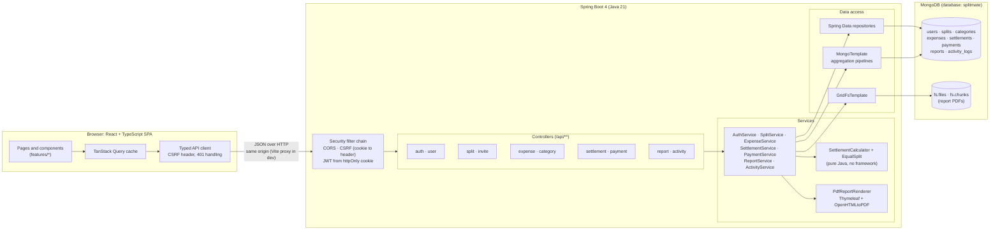
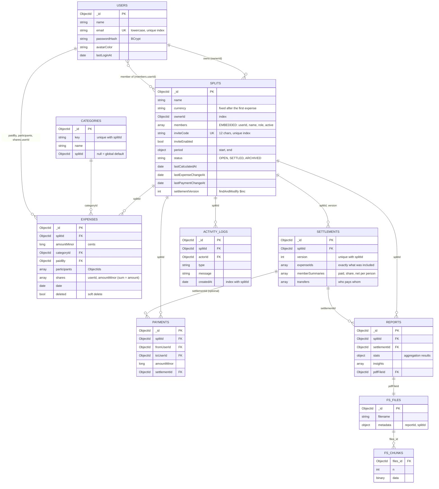
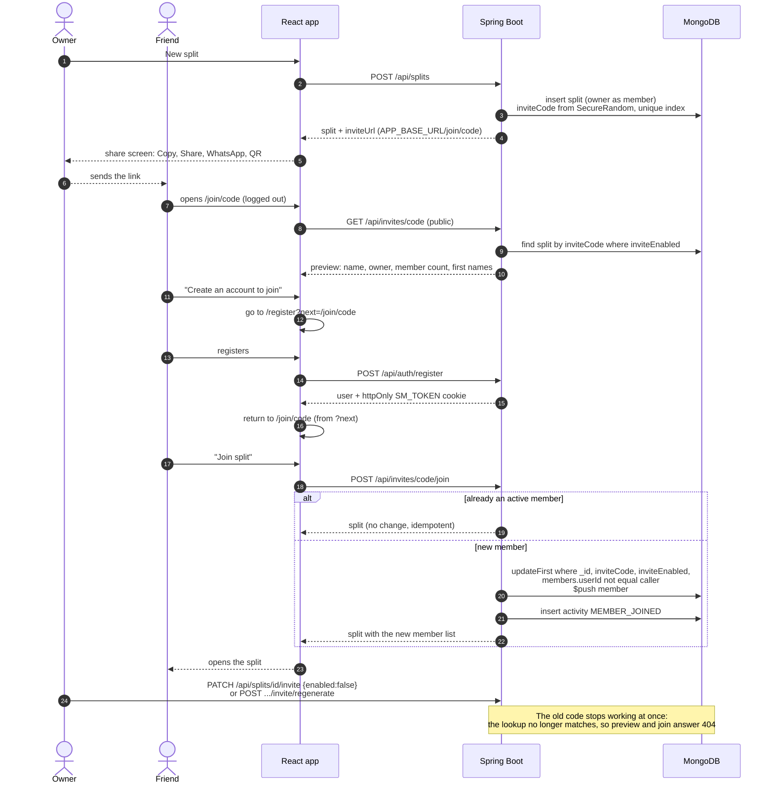
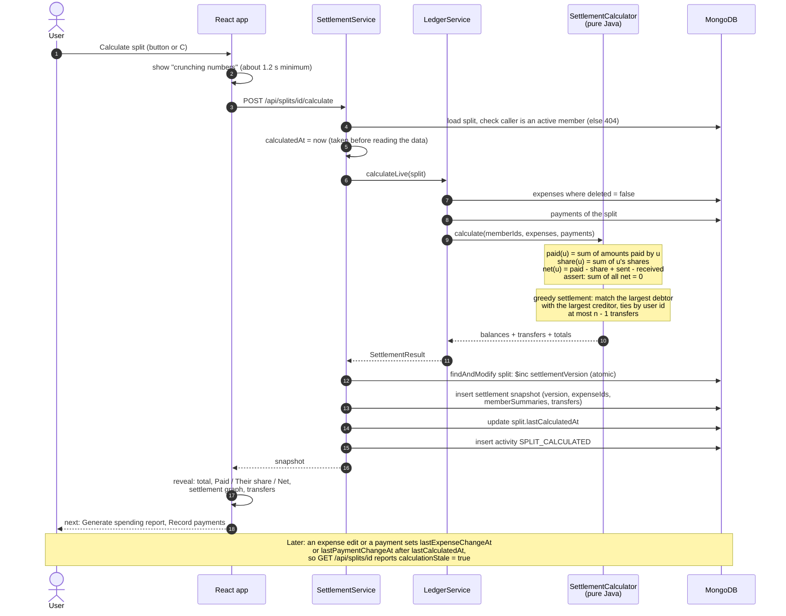
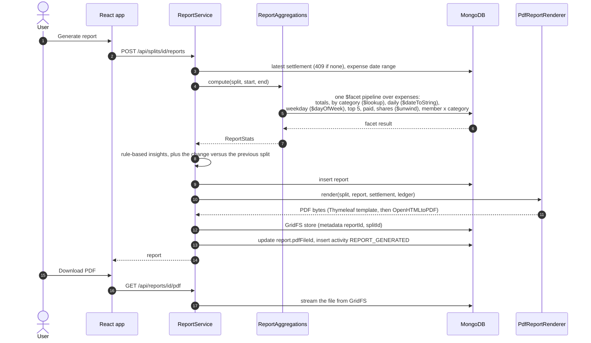

# Architecture

SplitMate is one Spring Boot application (Java 21) that serves a JSON API, plus a React single-page app, on top of one
MongoDB database. In development the two run as separate processes; in a production build the React app is bundled into the
jar and everything is served from one port.

Contents: [system](#1-system-architecture) · [collections](#2-collection-relationships) ·
[invite flow](#3-invite-flow) · [calculate flow](#4-calculate-flow) · [report flow](#5-report-flow) ·
[design decisions](#design-decisions)

---

## 1. System architecture

**How a request travels.** The browser calls `/api/...` on its own origin (in development the Vite dev server proxies `/api` to
port 8090, so the cookie is same-origin). The security filter chain reads the JWT from the `SM_TOKEN` cookie (or an
`Authorization: Bearer` header), checks the CSRF header on writes, and sets the caller. Controllers validate the request and
delegate to services. Every split-scoped service first calls `SplitAccess.requireMember`, which answers **404** (not 403) to
non-members so the existence of a split is never leaked. Services use Spring Data repositories for simple reads and writes,
`MongoTemplate` for atomic conditional updates and aggregation pipelines, and `GridFsTemplate` for PDFs.

**Layers and where the maths lives.** All money arithmetic is on `long` cents and lives in
`settlement/engine` (`EqualSplit`, `SettlementCalculator`), which has no Spring or MongoDB imports and is unit tested on its own,
including a 1,000-case randomised property test.

---

## 2. Collection relationships

Ids are `ObjectId`s. Members are **embedded** in the split (groups are small and bounded). Everything else refers to a split by
`splitId`. There are no multi-document transactions; each write is a single-document operation, with conditional updates where
concurrency matters (joining, the settlement version counter).

Indexes created by the application at startup (`@Indexed`, `@CompoundIndex`): `users.email` (unique), `splits.inviteCode` (unique),
`splits.members.userId`, `splits.ownerId`, `expenses {splitId, date}`, `{splitId, deleted}`, `{splitId, paidBy}`,
`settlements {splitId, version}` (unique), `activity_logs {splitId, createdAt}`, `categories {splitId, key}` (unique) and
`reports {splitId, generatedAt}`. See query 17 in [mongodb-queries.md](mongodb-queries.md).

---

## 3. Invite flow

A split gets an unguessable 12-character base62 code from `SecureRandom`. The public preview shows only first names. Joining is
idempotent and safe under concurrency because the member is added with a single guarded update.

---

## 4. Calculate flow

Pressing **Calculate split** stores an immutable, versioned snapshot. The stored `lastCalculatedAt` is compared with
`lastExpenseChangeAt` and `lastPaymentChangeAt` to flag a **stale** calculation ("Expenses changed since the last calculation.
Recalculate.").

The same formula is used for the live balance on the dashboard (`BalanceQueries`, a `$facet` aggregation), and an integration test
checks the two agree.

---

## 5. Report flow

---

## Design decisions

| Decision | Why |
|---|---|
| Money is a `long` of cents everywhere | No floating point near money. Parsing accepts `86,40`, `86.40`, `1.234,50`; display uses exact decimal strings. |
| Shares are computed on the server and stored on the expense | The base `amount / n` goes to everyone and the remainder cents to the first participants by id, so shares always sum to the amount exactly. |
| Embedded members, referenced everything else | A split has a handful of members (read with every request); expenses and snapshots grow, so they are separate collections. |
| No transactions | Works on a standalone `mongod` (no replica set). Each operation is one document, with guarded updates for joins and a `findAndModify` counter for snapshot versions. |
| Soft-deleted expenses | The document stays visible in the database and in the activity log but is excluded from all calculations. |
| Settlement snapshots are immutable | "What did the app say at the time" stays answerable; each carries the exact expense ids it used. |
| 404 for non-members | Split ids cannot be probed. Owner-only actions return 403 to other members. |
| Auth cookie + CSRF | An httpOnly, SameSite=Lax cookie holds the JWT (invisible to scripts); CSRF uses the cookie-to-header pattern. Requests that authenticate with an explicit `Authorization` header skip CSRF, since a browser cannot forge that header. |
| Dates as UTC `LocalDate` | The driver's java.time codecs store `2026-10-12` as midnight UTC, so `$dateToString` and `$dayOfWeek` land on the right day. |
